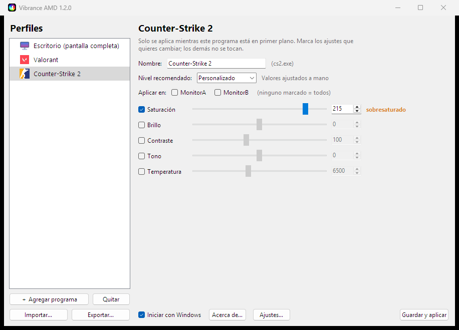
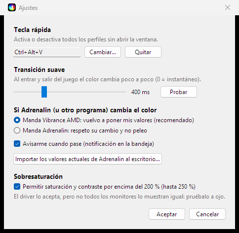

# Vibrance AMD

> **ES** · Color por juego para tarjetas **AMD Radeon** en Windows: la alternativa a *Vibrance GUI* (solo NVIDIA).
> **EN** · Per-game color (saturation, contrast…) for **AMD Radeon** GPUs on Windows — an alternative to NVIDIA-only *Vibrance GUI*. (English summary at the bottom.)



Sube la saturación (o brillo, contraste, tono, temperatura) **solo mientras un juego concreto está en primer plano**
—Valorant, CS2, Apex Legends, lo que elijas— y al salir del juego vuelve a tus valores de antes. Cada juego tiene su
**propio perfil**, y el color del **escritorio** es un perfil aparte y opcional.

## Qué hace
- **Perfil por juego** con saturación, brillo, contraste, tono y temperatura; el icono de cada programa se detecta solo.
- **Elige en qué monitor(es)** se aplica cada perfil (si tienes más de uno).
- **Transición suave** al entrar y salir del juego (tú eliges la duración; botón *Probar* para verla).
- **Tecla rápida configurable** (por defecto `Ctrl+Alt+V`) para activar/desactivar todos los perfiles sin abrir la ventana.
- **Recuerda el nivel** de cada programa (Suave, Equilibrado, Competitivo, Intenso, Máximo, Extremo o *Personalizado*).
- **Sobresaturación opcional**: saturación y contraste hasta **250 %** (ver aviso abajo).
- **Convive con Adrenalin**: tú decides quién manda si cambia el color (ver abajo) y puedes **importar** los valores actuales de la pantalla.
- **Importar / exportar perfiles** en un archivo de texto para compartirlos.
- Habla únicamente con el **driver de AMD** (librería ADL). **No inyecta, no lee memoria ni toca el juego.**
- Icono en la bandeja, arranque opcional con Windows y una sola ventana de configuración aunque la abras varias veces.



## Uso
1. Compila/descarga `VibranceAMD.exe` (ver *Compilar*) y ábrelo junto a su `config.json` (es portable).
2. Doble clic en el icono de la bandeja → **Configuración** → **＋ Agregar programa**: elige el juego de la lista de programas abiertos y un nivel.
3. Ajusta lo que quieras y pulsa **Guardar y aplicar** (se aplica solo, sin reiniciar).

## Adrenalin y este programa
- **Quién manda.** En *Ajustes → Si Adrenalin (u otro programa) cambia el color* eliges: **manda Vibrance AMD** (vuelve a poner tus valores
  mientras el perfil está activo) o **manda Adrenalin** (se respeta su cambio y no se pelea). Opcionalmente avisa con una notificación.
- **Importar de Adrenalin.** *Ajustes → Importar los valores actuales de Adrenalin al escritorio* lee lo que hay **ahora mismo** en tu pantalla
  (solo lo que difiere del valor por defecto) y lo guarda como color de escritorio para que lo gestione Vibrance AMD; desmarca
  «Aplicar este color al escritorio» para devolver el control a Adrenalin.
- **Limitación:** ADL **no da acceso a los perfiles por juego de Adrenalin**, solo a los valores actuales de la pantalla. Hazlo fuera de un juego.

## Sobresaturación (por encima de 200 %)
El driver **acepta y devuelve** valores por encima del 200 % que informa (comprobado hasta 250 en una RX 6600). Lo que **no se puede
medir por software** es cuánto sigue cambiando la imagen: depende del monitor, pruébalo a ojo. Tope de seguridad: 250 %. Se puede desactivar en *Ajustes*.

## Compartir perfiles
*Exportar…* guarda un `.txt` legible (JSON) **sin rutas ni datos de tu PC**; *Importar…* lo valida (solo nombres de `.exe` simples y números en rango) y te
pide confirmación. Formato:

```json
{
  "formato": "vibrance-amd-perfiles", "version": 1,
  "perfiles": { "VALORANT-Win64-Shipping.exe": { "nombre": "Valorant", "nivel": "Competitivo", "saturacion": 170, "contraste": 105 } }
}
```

## Configuración a mano
`config.json` se recarga solo. Rangos: saturación/contraste 0–200 (250 con sobresaturación; 100 = normal), brillo −100–100, tono −30–30, temperatura 4000–10000.

```json
{
  "intervalo_segundos": 1.0,
  "ajustes": { "tecla_rapida": "Ctrl+Alt+V", "transicion_ms": 400, "conflicto": "app", "sobresaturacion": true, "avisos": true },
  "escritorio": { "activo": false, "saturacion": 100 },
  "perfiles": {
    "VALORANT-Win64-Shipping.exe": { "nombre": "Valorant", "nivel": "Competitivo", "saturacion": 170, "contraste": 105, "monitores": ["Modelo del monitor"] }
  }
}
```
`conflicto`: `"app"` o `"adrenalin"`. `monitores`: nombres de monitor (vacío = todos).

## Compatibilidad (léelo antes de abrir un Issue)
Usa **ADL**, la librería de AMD que instala el driver Adrenalin. **Probado únicamente** en una **Radeon RX 6600**
(RDNA 2), driver 32.0.21045.x, Windows 11, **un** monitor 1080p a 120 Hz.

| | |
|---|---|
| Otras Radeon con Adrenalin (RX 400/500, Vega, RX 5000/6000/7000…) | **Probablemente funciona, sin confirmar.** ADL es la API clásica de AMD; AMD recomienda ahora ADLX y podría retirar ADL algún día. |
| **Varios monitores** (selector de monitor), portátiles con gráfica integrada + dedicada, HDR, *Night light*/perfiles ICC | **Sin probar con hardware real** (la lógica está probada con un driver simulado). |
| NVIDIA / Intel | **No soportado** (para NVIDIA existe Vibrance GUI). |
| Pantalla completa exclusiva | Algunos juegos ignoran el cambio; usa «pantalla completa con ventana» si no lo notas. |

**¿Algo falla o quieres confirmar tu tarjeta?** Ejecuta `VibranceAMD.exe --diagnostico` (o menú de la bandeja → *Diagnóstico*): crea
`diagnostico.txt` con tu GPU, driver, monitores y qué ajustes admite cada pantalla (**sin datos personales**), y pégalo en un
[Issue](../../issues). Desde el código fuente, `python vibrance_amd.py --test` comprueba que ADL puede leer, cambiar y restaurar cada ajuste.

## Compilar
Requiere Python 3.9+ de 64 bits: ejecuta `build.bat` (genera `portable\VibranceAMD.exe`). Desde código: `pip install pystray pillow` y `python vibrance_amd.py`.

## Aviso importante
Este programa **solo cambia el color a través del driver de AMD**; no modifica ni lee ningún juego. Aun así, **no hay garantía**
de cómo trate un anticheat (Vanguard, VAC, etc.) cualquier programa externo: **úsalo bajo tu responsabilidad**. Proyecto
independiente: *AMD* y *Radeon* son marcas de Advanced Micro Devices, Inc.; no está afiliado ni respaldado por AMD, Riot Games ni Valve.

## Licencia y versiones modificadas
**Apache-2.0** (ver `LICENSE`) + archivo **`NOTICE`**. Eres libre de usarlo y modificarlo. Si publicas una versión modificada
debes **conservar el `NOTICE`** (incluye el **enlace a este proyecto original**), **indicar que es una versión modificada** y qué
cambiaste. Así cualquiera puede comparar tu versión con la original y elegir. Sugerencia de texto para tu README:

> *Basado en [Vibrance AMD](https://github.com/Serchiio/vibrance-amd) (versión original). Esta versión está modificada: …*

---

## English summary
**Vibrance AMD** applies saturation/brightness/contrast/hue/temperature **only while a chosen game is in the foreground**
(Valorant, CS2, Apex…), restoring your previous values afterwards: one independent profile per game (per monitor if you want),
smooth transitions, a configurable global hotkey (default `Ctrl+Alt+V`), per-program level memory, optional over-saturation up to 250 %,
a choice of who wins when Adrenalin changes the color, and import/export of profiles as plain text. It talks only to the AMD driver (ADL) —
**it never touches the game**. **Tested only on a Radeon RX 6600 with one monitor**; other Radeon cards are *likely* to work but unconfirmed.
Run `VibranceAMD.exe --diagnostico` and paste `diagnostico.txt` in an Issue to report compatibility. Not affiliated with AMD, Riot or Valve;
no guarantee regarding anti-cheat software — use at your own risk. Licensed **Apache-2.0**; if you distribute a modified version you must keep
the `NOTICE` (link to this original project) and state that it is modified.
